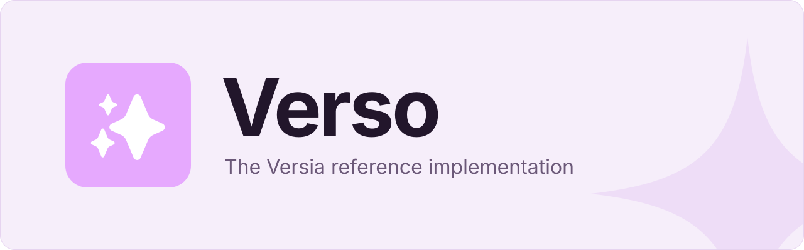

 

**[Docs](docs/README.md)** · **[Getting started](CONTRIBUTING.md#running-verso-locally)** ·
**[Contributing](CONTRIBUTING.md)** · **[Versia](https://versia.pub)**

Verso is the reference implementation of [Versia](https://versia.pub), a federation protocol for
social media. It also speaks the Mastodon client API, so it works with the apps people already use.

> [!NOTE]
> Verso is in early development and isn't ready for production yet.

## Features

- **Versia 0.6 federation**: statuses, follows, shares, reactions and custom emoji
- **Mastodon client API**: works with existing apps, including streaming, notifications and Web Push
- **Search** across statuses, accounts and hashtags
- **Sign-in** through OpenID Connect
- **Media storage** on local disk or any S3-compatible service
- **PostgreSQL or SQLite** as the database
- **Scales out** by running web nodes and job workers separately

## Running Verso

- **Locally**: follow [Running Verso locally](CONTRIBUTING.md#running-verso-locally).
- **On NixOS**: import the module from [`nix/module.nix`](nix/module.nix). See
  [Configuration](docs/configuration.md#nixos).
- **In a container**: build the image with Nix. See
  [The container image](docs/build-and-ci.md#the-container-image).

Every setting is listed, with its default, in [`config.example.toml`](docs/config.example.toml).

## Documentation

The [docs](docs/README.md) explain how Verso works, and walk through common changes such as adding a
route or a table. [CONTRIBUTING.md](CONTRIBUTING.md) covers setup, everyday commands and what we
look for in a pull request.

## License

Verso is free software, licensed under the [GNU Affero General Public License v3.0](LICENSE).
